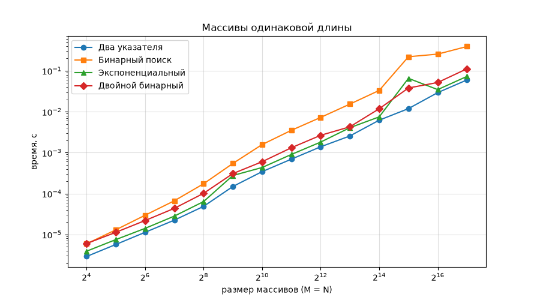
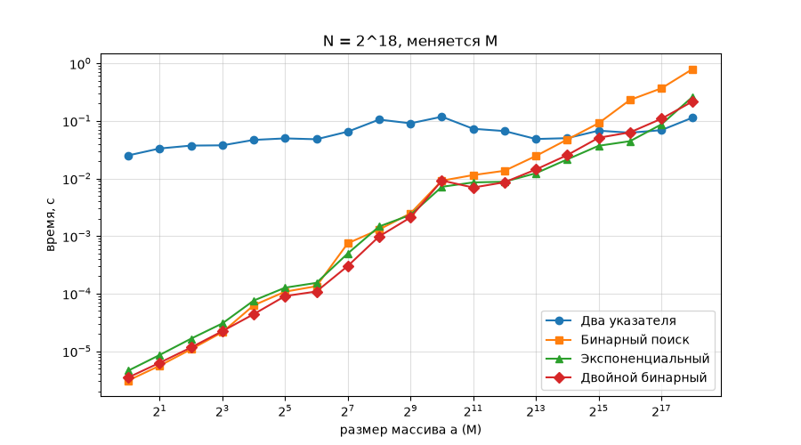
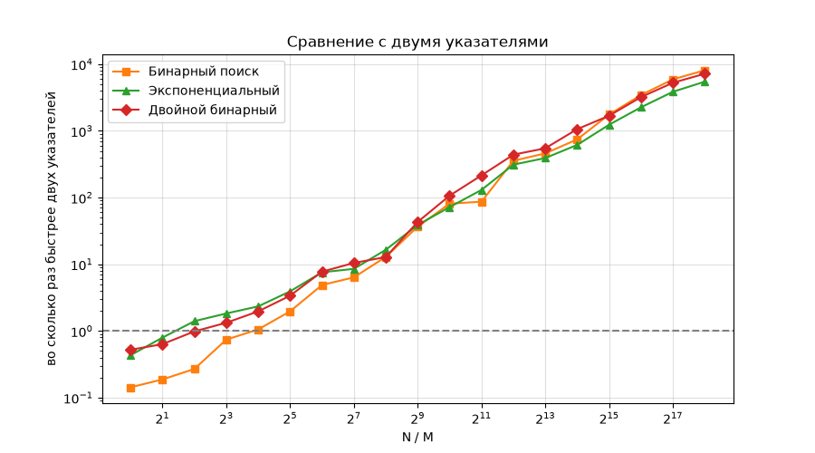

# Лабораторная работа 1. Общий элемент двух отсортированных массивов

Даны два отсортированных массива целых чисел длины M и N. Нужно вернуть `True`, если у них есть хотя бы один общий элемент, иначе `False`.

```
[1, 2, 3], [3, 4, 5]  ->  True
[2, 4, 6], [3, 5, 7]  ->  False
[], []                ->  False
```

Цель: написать 4 решения и выяснить, какое из них быстрее при разных размерах массивов.

## Алгоритмы

| Алгоритм | Функция | Время | Память |
|---|---|---|---|
| Два указателя | `two_pointers` | O(M + N) | O(1) |
| Бинарный поиск | `binary_search` | O(M log N) | O(1) |
| Экспоненциальный поиск | `exponential_search` | O(M log(2N/M)) | O(1) |
| Двойной бинарный поиск | `double_binary` | O(M log(2N/M)) | O(log M) |

- **Два указателя** - идём по обоим массивам и сдвигаем указатель, где элемент меньше.
- **Бинарный поиск** - каждый элемент a ищем бинарным поиском в b.
- **Экспоненциальный** - как два указателя, но по b прыгаем шагами 1, 2, 4, 8... а потом добиваем бинарным поиском.
- **Двойной бинарный** - берём середину a, ищем её место в b и рекурсивно делаем то же для левой и правой половин.

## Как мерил

- Худший случай, как советуют в задании: в b нечётные числа, в a чётные, равномерно раскиданные по b. Общих элементов нет, поэтому каждый алгоритм проходит до конца.
- Каждый замер 7 раз, на графиках медиана.
- Три эксперимента: M = N; N = 2^18 и меняется M; сетка разных M и N.

## Результаты

### M = N



Два указателя быстрее всех на всех размерах. Бинарный поиск на больших массивах медленнее примерно в 6-7 раз.

### N фиксированное, M меняется





Когда M маленькое, два указателя проигрывают в тысячи раз, потому что всё равно проходят весь b.

### Итог

| Соотношение размеров | Что быстрее |
|---|---|
| массивы примерно одной длины | два указателя |
| один больше другого в 4-32 раза | экспоненциальный поиск |
| один массив сильно меньше | двойной бинарный или обычный бинарный |

Подробные таблицы и выводы по каждому эксперименту в ноутбуке.

## Что где лежит

```
Лаба_1/
├── lab1.ipynb         код, проверка, замеры, графики, выводы
├── requirements.txt
└── results/
    ├── exp1.csv       сырые данные (все 7 запусков на каждую точку)
    ├── exp2.csv
    ├── exp3.csv
    ├── exp1.png
    ├── exp2.png
    └── exp2_ratio.png
```

## Как запустить

```
pip install -r requirements.txt
jupyter notebook lab1.ipynb
```

Весь ноутбук выполняется минуты 3-4. Время каждый раз получается немного разное, так что цифры могут отличаться от моих.
